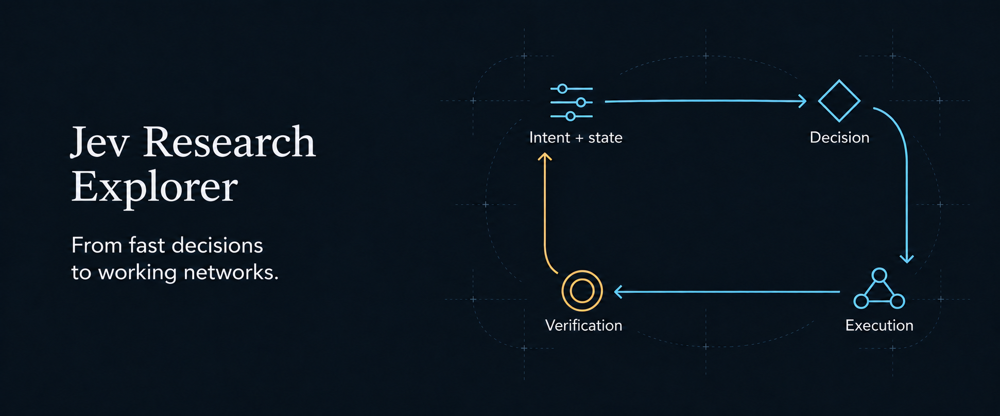

# Jev Research Explorer

Three studies from the [UTSCybeR lab](https://utscyber.com/) on intent interpretation and decision-making in communication networks. Follow the path from intent and network state to a decision, its execution, and a verified outcome.

**[Explore →][home]** · [Directions](#directions) · [Chart data][data]

[中文网站](https://delong-l.github.io/Jev-Research/?lang=zh#top) · [中文说明](README.zh-CN.md)

[][home]

## Follow the result through the loop

Decision latency, execution acknowledgment, and verified outcomes use different endpoints. Read them alongside policy correctness, queueing, and service completion to understand what a fast decision delivers.

## Three research directions

### Wireless network control

Inspect radio SLA violations, cell-edge throughput, and packet delay across arrival rates and UE speeds. Connect these outcomes to policy correctness, deadline fit, queues, and the A1/E2 control path.

[Explore wireless control →][wireless]

### Edge service orchestration

Compare correct, on-time completion under different loads, deadlines, and semantic cache conditions. Explore live admission with modeled service execution and a real OCR service; use A/B comparisons to inspect recorded conditions.

[Explore edge services →][edge]

### Closed-loop verification

Follow a decision through execution ACK to a verified outcome. Examine queue-and-replay results, constraint checks, and the literature explorer's coverage of measurement endpoints and check responsibility.

[Explore verification →][verification]

## Explore the recorded conditions

- **Choose a condition.** Inspect scenarios, timing budgets, and reported aggregates. The views distinguish simulated outcomes, live model calls, modeled execution, and software-stack measurements.

- **Compare with context.** In the edge A/B view, pin one condition while changing the other. Read completion counts together with request p95.

- **Keep your place across languages.** Switching between English and Chinese preserves the selected conditions and exploration state.

<strong>View the actual explorer</strong>

[][home]

[Open the interactive explorer →][home]

## Read the evidence

[Studies and datasets][studies] · [Chart data JSON][data] · [Explorer guide](guides/explorer.md)

Timing fit, policy correctness, and verified completion have different definitions and denominators. Consult the measurement notes for the selected view before comparing results.

<strong>What should I check when comparing results?</strong>

- **Evidence source:** distinguish simulations, measured model calls, modeled service execution, and real software or service measurements.

- **Completion and latency:** request p95 uses each model's own completed requests. Keep the completion counts beside the latency comparison.

- **Timing thresholds:** the timing-target lookup uses sampled budgets without interpolation.

The [explorer guide](guides/explorer.md) explains each view and links the three studies to their papers, code, and full datasets.

## Licence

Website source: [MIT](LICENSE). Bundled IBM Plex fonts retain the [SIL Open Font License 1.1](assets/fonts/OFL.txt).

[Explore the research][home] · [Explorer guide](guides/explorer.md) · [Cover and asset notes](guides/visuals.md)

[home]: https://delong-l.github.io/Jev-Research/?lang=en#top
[wireless]: https://delong-l.github.io/Jev-Research/?lang=en#radio-timing
[edge]: https://delong-l.github.io/Jev-Research/?lang=en#edge-orchestration
[verification]: https://delong-l.github.io/Jev-Research/?lang=en#control-verification
[studies]: https://delong-l.github.io/Jev-Research/?lang=en#studies
[data]: https://delong-l.github.io/Jev-Research/explorer-data.json
